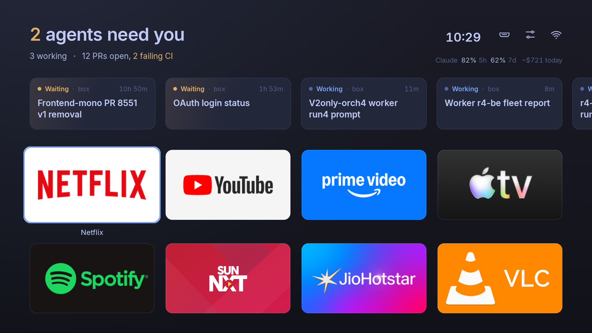
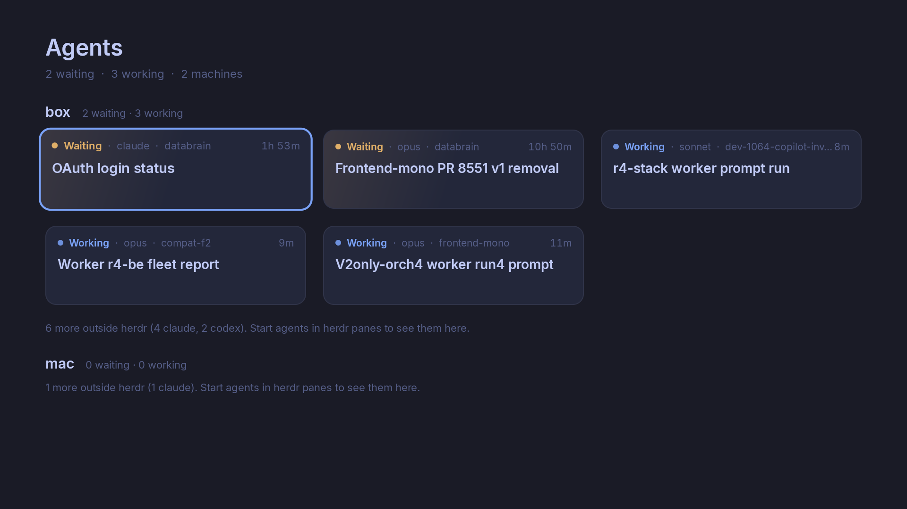
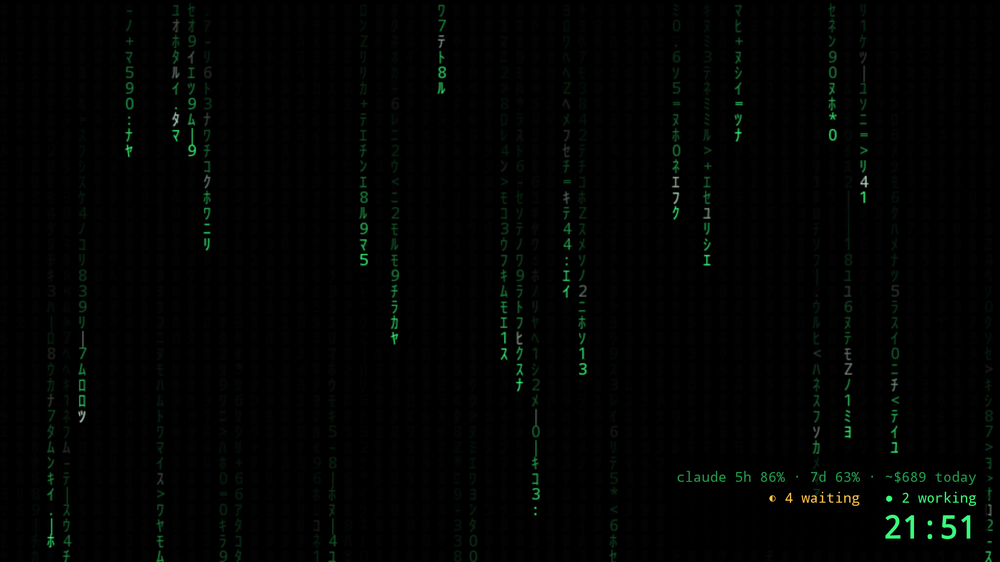

# boxdeck-tv

An Android TV home screen that shows your coding agents. From the sofa you see which Claude Code and
Codex agents are working and which ones stopped and want you, on every machine
[boxdeck](https://github.com/wicolian/boxdeck) watches, over Tailscale.



## What you get

- **A calm home screen.** A headline answers the one question: *does anything need me?* ("1 agent needs
  you"). Under it is a slim strip of agent cards, waiting first. Your apps get most of the screen as
  large logos, four to a row. No
  ads, no suggestion rows. App logos keep their own colours, because that is how you find an app from
  across the room.
- **A status light on every card,** like the LEDs on a router. Amber and steady when an agent waits
  for you. The theme's accent, slowly breathing, while it works. Nothing blinks.
- **Omarchy themes, built in:** Tokyo Night, Catppuccin, Gruvbox, Nord, Everforest, Kanagawa, Rosé Pine,
  Matte Black, Osaka Jade, Ristretto, plus Terminal (green phosphor) and Classic. Pick one under
  Settings → Theme, which previews it live. Or bring your own:
  `--es theme_custom "bg=#1a1b26,surface=#24283b,fg=#c0caf5,dim=#565f89,accent=#7aa2f7,warn=#e0af68"`.
  Settings also has the layout (Shelf or Grid), the font (Inter or JetBrains Mono, both bundled) and
  alerts.
- **Fast on a slow TV.** Navigating runs at 60 fps on an Acerpure ACP75P (Google TV 14): median frame
  10 ms, p90 11 ms, 0 janky frames. It uses 82 MB of memory, against 127 MB for the Google TV home
  screen. To get there it uses no live blur, and it paints the background once instead of every frame.
  The surfaces are solid colours mixed to look like glass, and the only constant motion is the
  breathing light, at 15 fps.
- **Every herdr pane, full screen.** Press OK on any card. You get the same cards in a grid, grouped by
  machine, waiting first. Agents outside herdr have no status, so they fold into one line per machine.
  Pressing Home from anywhere brings you back to the first app.

  

- **Alerts, off by default.** Turn them on under Settings → Alerts. Then a toast shows, even during
  Netflix, when something changes:
  - a pane goes from working to waiting
  - a machine goes offline
  - a PR starts failing CI
  - a Claude quota window drops under 20%
  - a disk goes over 90%

  After 30 minutes or more with the screen off, you get a "While you were away" summary instead.
- **PRs and CI** in the headline's second line: "12 PRs open, 2 failing CI". boxdeck fetches them with
  the hub's own `gh` login ([boxdeck#52](https://github.com/wicolian/boxdeck/pull/52)), so the TV never
  holds a GitHub token.
- **A Matrix screensaver** in your theme's colours. Above the clock it shows your agents and your
  quota.

  
- **It stays reachable after a restart.** Google TV turns wireless debugging off at every boot, and
  Tailscale does not reconnect by itself. The watcher turns both back on.

## Set up

You need a TV running Android TV or Google TV with developer mode, `adb`, Java 17 and the Android SDK
(platform 34, build-tools 34), and boxdeck built from `main` after [PR #51](https://github.com/wicolian/boxdeck/pull/51) (read-only tokens) on each machine.

1. **Tailscale on the TV.** Install it from the Play Store and sign in.
2. **A read-only token on each machine.** On every machine that runs boxdeck:

   ```sh
   boxdeck token new --read-only tv
   ```

   A read-only token (`bdr_...`) can only read `/api/boxes`, `/api/agents`, `/api/usage`,
   `/api/github` and `/api/health`. **Never put a full token (`bd_...`) on a TV.** A full token can run commands on the
   machine through `/api/run`.
3. **Build and install.**

   ```sh
   sh build.sh
   BOXDECK_URL=http://<hub tailscale ip>:8100 \
   BOXDECK_TOKEN=bdr_...        \  # the hub's read-only token
   BOXDECK_TOKEN_MAC=bdr_...    \  # one per other machine, named as boxdeck names it
   sh install.sh <TV_IP>
   ```

   Use the hub's Tailscale IP, not its name. If the TV uses Private DNS, MagicDNS names do not resolve.

The hub's `/api/boxes` lists every machine, and the TV reads each machine's `/api/agents` with that
machine's token. To add a machine to the hub, add it to `boxes` in the hub's boxdeck config.

## The TV's own home screen

On most Google TVs the stock home screen still wins the Home button, even after `install.sh`. The only
way past it is to turn it off:

```sh
adb shell pm disable-user --user 0 com.google.android.apps.tv.launcherx
adb shell pm disable-user --user 0 com.google.android.tungsten.setupwraith
```

**This has a real risk.** On some Google TVs, a Chromecast for example, turning these off left the
device stuck restarting, and only a factory reset fixed it. Do it only if you can reach the TV over
adb after a restart. This app's wireless-debugging keeper exists for exactly that. It worked on an
Acerpure ACP75P (Google TV 14) through several restarts. To undo it, run `pm enable` on both packages.
For removing ads and bloat, see [tv-detox](https://github.com/Ansub/tv-detox), whose home screen this
one grew from.

## Permissions, and why

| Permission | Why |
|---|---|
| `INTERNET` | Reading boxdeck. Nothing else talks to the network. |
| `FOREGROUND_SERVICE`, `..._SPECIAL_USE` | The watcher, so toasts work while another app is open. |
| `WRITE_SECURE_SETTINGS` | Only when granted over adb. Turns wireless debugging back on. To revoke: `adb shell pm revoke dev.wicolian.boxdecktv android.permission.WRITE_SECURE_SETTINGS`. |
| cleartext HTTP | boxdeck on the tailnet is plain HTTP inside WireGuard. |

The watcher also sends Tailscale's own `CONNECT_VPN` broadcast, at boot and when boxdeck can't be
reached, at most once every 2 minutes.

## Credits

The home screen code (tiles, inputs, wallpapers, editing) comes from
[Ansub/tv-detox](https://github.com/Ansub/tv-detox) under the MIT license. The agents panel, the panes
view, the watcher, the terminal look and the screensaver are new here. MIT, see [LICENSE](LICENSE).
